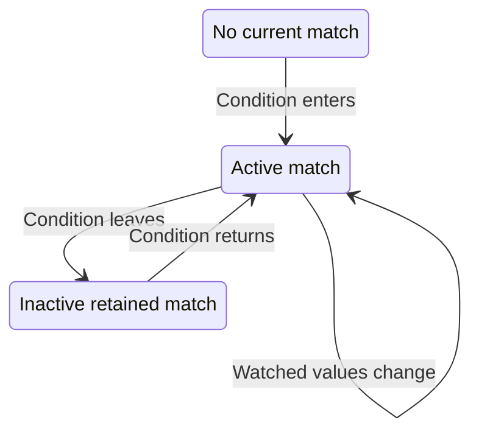

# Lifecycle and delivery

[Explanation](index.md) · [Concepts](../concepts.md)

An order can be an active match before a review task appears. That is expected: the condition, its lifecycle, and the execution of a consequence answer different questions at different points in the runtime. Understanding those boundaries helps you design useful application state and avoid treating every delay as a failed rule.

## One business identity, several transitions

Imagine order 42 below the review threshold. It enters the condition when its amount rises, remains there while its amount changes again, leaves when it becomes safe, and returns after a later change. The business identity stays `42`; generation distinguishes separate active periods, and revision distinguishes watched changes inside one period.

| Observation | Generation | Revision | Possible command event |
| --- | --- | --- | --- |
| Order first enters after deployment | `1` | `0` | `ACTIVATE` |
| Watched amount changes while active | `1` | `1` | `CHANGE` |
| Order leaves the condition | Same active-period identity | Last active revision retained | `DEACTIVATE` |
| Order later returns | `2` | `0` | `ACTIVATE` |

This example begins with no match and a source change after deployment. Bootstrap is a separate case: `SEED_CURRENT` records already-matching rows without treating them as newly entered command work. That prevents deployment itself from silently replaying every existing business action, but it also means you must plan an initial task migration if your application needs one.

## A match does not prove execution

The condition relation says which facts satisfy the policy. `pgreact.matches` records the deployed rule's interpretation and lifecycle. `pgreact.work` records durable execution requests, and `pgreact.attempts` records tries at executing them. Finally, an application table such as `app.manual_review_tasks` records the effect that your consequence chose to produce. Each is valuable evidence, but none should be substituted for another.

For example, a completed match refresh can create pending work while the worker is still processing an earlier batch. A consequence can fail and leave a `RETRY_WAIT` attempt while the match remains active and correct. Conversely, an application task can remain after a match deactivates if your declaration has no deactivation consequence. The first tutorial intentionally demonstrates only activation; the [order-review tutorial](../order-review-tutorial.md) adds task revision and closure.

## Coordination and execution have different completion points

The managed worker normally polls each configured database, coordinates the relevant source frontier, and executes eligible durable work. An explicit `pgreact.run()` is useful when you intend coordination, but it is not a request to wait until every resulting consequence completes. A successful source update or run result therefore needs a separate work/attempt observation when your next step depends on the effect being finished.

This distinction also matters for transactions. A background worker cannot observe your uncommitted source changes, so a long transaction containing a source update and repeated waiting queries can prevent the very progress you are waiting for. In a learning session, use normal autocommit. In an application, make the commit boundary and the later observation of asynchronous work explicit.

## Local transactions and external delivery

A database-local consequence executes with pg-react's bookkeeping inside PostgreSQL transaction boundaries. If it fails, its database changes are rolled back rather than being recorded as a completed effect. Retrying should still be safe: uniqueness constraints, upserts, and stable idempotency identities make the intended business effect clear across execution and recovery paths.

A network service is outside that local transaction. An outbox lets PostgreSQL commit the intent to deliver, but a sender can crash after the remote system accepts a request and before the local delivery acknowledgment is durable. Retrying can then deliver the request again. That is why the contract is at least once and why the external consumer must deduplicate a stable delivery identity; the number of successful SQL statements does not establish exactly-once remote behavior.

## Changing policy does not erase its past

Replacement introduces a new reviewed declaration while old work may still exist. `DRAIN_OLD` and `CANCEL_OLD` make the disposition of that work explicit rather than letting the system guess. A policy's stable public name is useful for finding all authorized active, paused, or draining versions during lease recovery, but it does not make every historical version identical to the current one.

Use [Changing policies safely](../changing-policies.md) to plan the cutover, and [Operations](../operations.md) to inspect the resulting state. When a later explanation must remain available after current evidence changes, consider a retained evidence snapshot; [Advanced use](advanced-use.md) explains how historical evidence differs from current truth.
